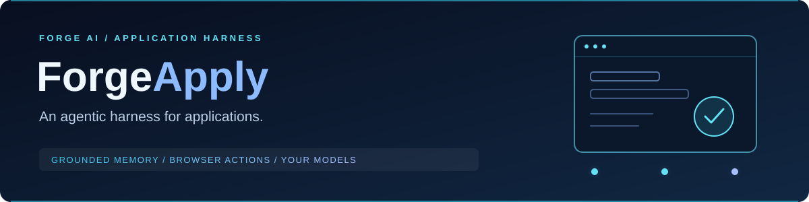

<div align="center">



### Prepare carefully. Apply with confidence.

[Getting started](docs/USAGE.md) · [Chrome extension](extension/README.md) · [What's new](CHANGELOG.md) · [Verified capabilities](RELEASE_READINESS.md)

[](https://github.com/ANASS19/ForgeApply/actions/workflows/tests.yml)


</div>

---

ForgeApply is a Windows-first application workspace that helps you prepare permitted job applications in **English and Italian**. Keep your profile and documents locally, fill verified facts, review AI-assisted answers, and track your applications in one dashboard.

**Development preview:** tested with real Chromium against controlled forms. Live employer completion, every ATS variant, and production reliability are not guaranteed. Final submission stays under your control. [Read the evidence and release gaps](RELEASE_READINESS.md).

## What you can do

| Workflow | Included in this preview |
|---|---|
| Keep a reusable profile | Contact details, multiple employment/education records, certifications, languages, skills and EN/IT CVs |
| Complete supported steps | Bounded observe/plan/act/verify loop, pause/resume, local checkpoints and a visible virtual cursor |
| Fill an existing Chrome tab | Compact extension, persistent connection, Keep open side panel, reviewed missing answers |
| Prepare complex forms | Native/custom selects, radio groups, factual checkboxes, dynamic fields, repeated sections, multi-page review |
| Use your preferred model | Local Ollama, local or hosted OpenAI-compatible endpoints, or deterministic filling without AI |
| Draft application materials | Editable bilingual CV/letter drafts and reviewed local PDF/text export |
| Track opportunities | SQLite history, job queue, CSV import/export and public Greenhouse/Lever/Ashby feeds |

Unknown qualifications and personal facts are never intentionally guessed. Legal/consent and protected demographic fields stay manual. LinkedIn/Indeed native inspection and autofill are disabled; use employer application pages where assistance is permitted.

## Start on Windows

Install **Python 3.13** and Git, then:

```powershell
git clone https://github.com/ANASS19/ForgeApply.git
cd ForgeApply
py -3.13 -m venv .venv
.venv\Scripts\python.exe -m pip install -r requirements.txt
.venv\Scripts\python.exe -m playwright install chromium
.venv\Scripts\python.exe -m forgeapply
```

Open **http://127.0.0.1:8765**. You can also use `start_windows.bat` after downloading and extracting the source. Python 3.11+ is supported; Windows 3.13 is the local validation environment. Linux/macOS users can use `sh start_linux_mac.sh`; macOS has not been independently verified.

## Your first application

1. In **Candidate & CVs**, enter verified contact/background facts and upload your documents.
2. At `chrome://extensions`, enable Developer mode → **Load unpacked** → choose this repository's **extension** folder.
3. Generate a code in dashboard **AI Settings → Chrome extension**, then enter it once in the assistant. The connection stays saved until disconnected or revoked.
4. Open a permitted application page. Open ForgeApply, choose **Keep open**, then **Complete Application**. It fills verified fields, handles supported page transitions, and pauses when you need to act.
5. Enter missing facts and review drafts → **Fill reviewed answers**. Choose a CV using **Attach CV / document**, then **Resume application**.
6. Review personal/legal fields on the website and resume explicitly. The agent stops at final review; submit manually if you choose. **Prepare & Fill this page** remains available for page-by-page control.

Practice first at dashboard `/demo/en` or `/demo/it`; final submission is disabled. The [usage guide](docs/USAGE.md) includes model setup, realistic multi-page practice, upgrades and troubleshooting. [Guida rapida in italiano](docs/USAGE.md#guida-rapida-in-italiano).

## Choose your intelligence

- **No AI:** turn off **Use configured AI for unfamiliar questions** in extension Settings → More options. Known fields still fill; enter unknown answers yourself.
- **Ollama:** start Ollama, install a model, and select its exact name in AI Settings. `qwen3.5:9b` and `qwen3.5:4b` are measured advisory presets, not guaranteed requirements or safe autonomous decision makers.
- **OpenAI-compatible:** select the provider, model and base URL. Hosted endpoints require HTTPS, explicit remote consent and an environment API key. Local compatible endpoints can be keyless. See [provider setup](docs/USAGE.md#configure-ai-optional).

The [synthetic benchmark](benchmarks/README.md) found factual errors with both tested models. AI output always needs review; evidence references do not prove an answer is correct.

## Privacy and verification

Data is stored outside the repository under `%USERPROFILE%\.forgeapply` by default. The server binds to loopback; extension pairing is authenticated. No telemetry is implemented. SQLite, CVs and browser sessions rely on OS permissions and are **not application-encrypted**. Hosted inference can receive candidate facts and page content after opt-in; keep it off for local-only inference.

**108 tests pass on Windows Python 3.13**, including actual MV3 Chromium workflows, uploads, virtualized Workday-style catalogs, an Italian enterprise portal, partial-record recovery, pause/resume, replaced controls, ambiguous choices, page errors and final review. CI covers Windows/Ubuntu with Python 3.11/3.13. This is fixture evidence, not proof that every employer portal works. See the [regression evidence](docs/WORKDAY_VERIFICATION.md).

```powershell
.venv\Scripts\python.exe -m pytest -q
```

[Usage guide](docs/USAGE.md) · [Engineering reference](docs/ENGINEERING.md) · [Audit](AUDIT.md) · [Contributing](CONTRIBUTING.md)

## Project status and license

ForgeApply is part of the Forge AI project family. Multi-profile isolation, encrypted credentials, installers, unrestricted ATS support, scheduling and specialist-agent orchestration remain unfinished. The current implementation is one bounded preparation workflow, not a completed multi-agent platform.

A source license has not yet been selected. Public visibility alone does not grant unrestricted reuse rights. No Chrome Web Store or PyPI package is published by this preview.
